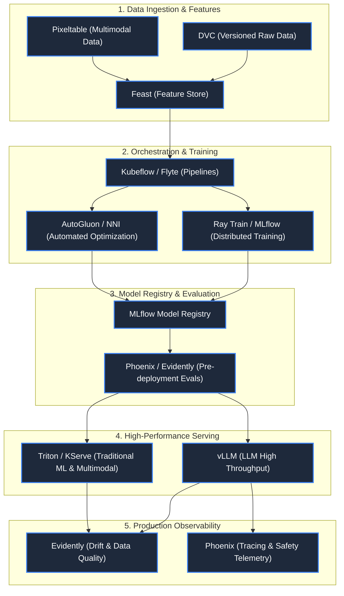

  

# 🚀 Awesome Enterprise AI & Machine Learning Platform

### A curated directory of enterprise AI/ML platforms, sovereign MLOps infrastructure, automated machine learning (AutoML) frameworks, feature stores, and high-performance model serving engines.

  
  
  
  
  
  

  <strong>Last updated: October 2026</strong> • Tracking enterprise-grade AI ecosystems, commercial SaaS, and open-source stacks.

---

## 📑 Table of Contents

- [🌐 Overview & Taxonomy](#-overview--taxonomy)
- [📊 Sector Overview & Market Dynamics](#-sector-overview--market-dynamics)
- [🏢 Enterprise SaaS & Hosted Platforms](#-enterprise-saas--hosted-platforms)
- [🛠️ Open-Source GitHub Projects](#️-open-source-github-projects)
- [🏗️ Sovereign Enterprise AI Architecture Blueprint](#️-sovereign-enterprise-ai-architecture-blueprint)
- [🔍 SEO Keyword Matrix & Enterprise Evaluation Criteria](#-seo-keyword-matrix--enterprise-evaluation-criteria)
- [❓ Frequently Asked Questions (FAQ)](#-frequently-asked-questions-faq)
- [🤝 How to Contribute](#-how-to-contribute)
- [⚖️ Disclaimer](#️-disclaimer)
- [⭐ Star History](#-star-history)
- [💖 Support & Sponsorship](#-support--sponsorship)

---

## 🌐 Overview & Taxonomy

Enterprise Artificial Intelligence and Machine Learning Platforms empower global organizations to build, fine-tune, orchestrate, deploy, observe, and govern machine learning and generative AI workloads at mission-critical enterprise scale. 

Modern enterprise AI platforms span five fundamental architectural pillars:
1. **Data Preparation & Feature Stores** 🏪: High-throughput ingestion, point-in-time correctness, and unified feature access across offline training and online low-latency inference.
2. **AutoML & Model Training** 🤖: Neural Architecture Search (NAS), automated hyperparameter optimization, distributed multi-node GPU clusters, and reproducible training pipelines.
3. **Model Packaging & Registry** 📦: Containerized artifact versioning, lineage tracking, experiment cataloging, and compliance auditability.
4. **Model Serving & High-Throughput Inference** ⚡: Dynamic batching, PagedAttention, KV cache management, multi-protocol serving (gRPC, REST), and Kubernetes autoscaling.
5. **Observability, Governance & Safety** 🛡️: Data drift detection, concept drift tracking, Hallucination/Safety firewalls, bias mitigation, and enterprise role-based access control (RBAC).

---

## 📊 Sector Overview & Market Dynamics

> **Market Size & Expansion**: The global Enterprise AI and Machine Learning Platform market was valued at **$25.8 Billion in 2024** and is projected to surpass **$118.5 Billion by 2030**, reflecting a compound annual growth rate (**CAGR**) of **28.9%**, driven by the relentless operationalization of foundational Large Language Models (LLMs), agentic workflows, and sovereign enterprise cloud mandates.
>
> **Market Structure & Concentration**: The sector exhibits a **bifurcated, moderately fragmented ecosystem underpinned by an oligopolistic infrastructure foundation**. Hyperscalers (Microsoft Azure, Google Cloud, AWS) command a winner-take-most position in foundational accelerated compute (GPUs/TPUs), baseline hosting, and native model gardens. Concurrently, the upper-tier layers—encompassing specialized automated machine learning (AutoML), feature stores, real-time observability, and vendor-agnostic governance—remain **highly fragmented and dynamic**, fostering vibrant competition between specialized enterprise SaaS pioneers (Dataiku, DataRobot, H2O.ai, Clarifai) and standard-setting open-source frameworks (MLflow, Kubeflow, vLLM, Feast, KServe).

---

## 🏢 Enterprise SaaS & Hosted Platforms

The following enterprise platforms provide managed, fully hosted cloud environments for corporate machine learning and generative AI operations. The table is **sorted descending by company size** (market capitalization for public enterprises or latest private valuation).

| 🏢 Platform & Provider | 💼 Company Size (Valuation / Revenue) | 🏷️ Specific Starting Pricing | 🎁 Specific Free Tier Limit | 🎯 Key Enterprise Focus & Capabilities |
| :--- | :--- | :--- | :--- | :--- |
| **[Microsoft Azure AI & Azure ML](https://azure.microsoft.com/en-us/solutions/ai/)**  *(Microsoft)* | **$3.12 Trillion** Market Cap  *(~$245B+ Annual Revenue)* | Pay-as-you-go VM compute from **$0.0104/hr** (`Standard_B1s`) & **$0.06/hr** (`Standard_DS1_v2`); Azure OpenAI from **$0.15 per 1M input tokens** (GPT-4o mini); Azure AI Search Basic from **$73.73/mo** | **30-Day Trial with $200 billing credit** + **12 months free** of 55+ services; Permanent **F0 Free Tier** for Cognitive Services (e.g., 5,000 transactions/mo for Computer Vision, 5 audio hrs/mo for Speech) | End-to-end enterprise ML lifecycle, Azure AI Studio/Foundry, seamless Microsoft 365 Copilot integration, enterprise security & compliance (HIPAA, FedRAMP). |
| **[Google Cloud Vertex AI](https://cloud.google.com/ai-platform)**  *(Alphabet / Google)* | **$2.15 Trillion** Market Cap  *(~$307B+ Annual Revenue)* | Custom training compute starting from **$0.049/hr** (`e2-standard-2`); Gemini 1.5 Flash at **$0.075 per 1M tokens**; AutoML image classification training at **$3.15/hr** | **90-Day Free Trial with $300 cloud credits**; Vertex AI Search free for first **1,000 queries/mo**; Gemini 1.5 Flash free forever up to **15 RPM & 1,000,000 TPM** via Google AI Studio | Vertex AI Pipelines, Model Garden, BigQuery ML integration, automated feature engineering, foundation model tuning, and generative AI search. |
| **[AWS SageMaker](https://aws.amazon.com/sagemaker/)**  *(Amazon / AWS)* | **$1.98 Trillion** Market Cap  *(~$575B+ Annual Revenue)* | Studio notebook compute from **$0.05/hr** (`ml.t3.medium`); Serverless Inference from **$0.000020/sec**; SageMaker Canvas tabular models at **$1.90/session-hour** | **60-Day (2-Month) Free Tier**: Includes **250 hours/mo** of `ml.t3.medium` on Studio, **50 hours/mo** of `ml.m4.xlarge`/`ml.m5.xlarge` training, and **125 hours/mo** of `ml.m4.xlarge` real-time hosting | Fully managed enterprise MLOps, Feature Store, SageMaker JumpStart, distributed training, Canvas no-code ML, Model Monitor, and Clarify bias detection. |
| **[Adobe Sensei & GenStudio](https://business.adobe.com/products/sensei/sensei.html)**  *(Adobe)* | **$220 Billion** Market Cap  *(~$21.4B Annual Revenue)* | Firefly standalone premium plans start at **$4.99/mo** (100 generative credits/mo); Adobe Experience Cloud Enterprise AI packages start at **$1,500/mo** per brand tenant | **Free forever plan includes 25 generative AI credits/mo**; Enterprise solutions include a **14-day guided proof-of-concept trial** with full sandbox API access | Multimodal generative AI for digital asset management, customer journey analytics, personalized content generation, and brand safety safeguards. |
| **[IBM watsonx](https://www.ibm.com/watsonx)**  *(IBM)* | **$205 Billion** Market Cap  *(~$62.5B Annual Revenue)* | watsonx.ai Essentials plan starts at **$1,050/mo**; Granite open foundation models from **$0.0006 per 1K input tokens**; On-demand Resource Units at **$0.60/RU** | **30-Day Trial with $200 IBM Cloud credits**; Permanent **watsonx Lite Free Plan** with **25,000 Resource Units/mo**, 1 deployment space, and 1 prompt template | Hybrid cloud enterprise AI, watsonx.ai studio, watsonx.data open data lakehouse (Apache Iceberg), and watsonx.governance for automated AI compliance. |
| **[DataRobot](https://www.datarobot.com/)**  *(DataRobot Inc.)* | **$6.3 Billion** Valuation  *(~$230M ARR)* | DataRobot Starter SaaS edition starts at **$2,500/mo** (billed annually at $30,000/yr); Dedicated Cloud Units from **$5.00/compute-hour** | **14-Day Full-Featured Free Trial** with **3 concurrent modeling workers**, automatic feature engineering, and up to **100 model training runs** | Automated Machine Learning (AutoML), production model registry, continuous drift monitoring, generative AI guardrails, and enterprise governance. |
| **[Dataiku](https://www.dataiku.com/)**  *(Dataiku)* | **$3.7 Billion** Valuation  *(~$260M ARR)* | Dataiku Online Starter plan starts at **$348/mo** (up to 3 users); Enterprise self-hosted packages start at **$4,083/mo** ($49,000/yr base contract) | **14-Day Free Cloud Trial** of Dataiku Online; Permanent **Dataiku Community Edition** (100% free self-hosted forever, capped at 3 users and single-node compute) | Collaborative visual data science, low-code/code-optional ML pipelines, feature store recipes, automated LLM prompt studios, and model cataloging. |
| **[C3 AI Platform](https://c3.ai/)**  *(C3.ai)* | **$3.2 Billion** Market Cap  *(~$310M Annual Revenue)* | C3 Generative AI Edition on AWS/Azure Marketplace starting at **$0.55 per application-hour**; Enterprise core platform base licenses from **$250,000/yr** | **14-Day Free Test Drive** on AWS and Azure Marketplaces with **$500 cloud infrastructure credits** included for evaluation | Turnkey enterprise AI applications for supply chain optimization, predictive maintenance, energy management, ESG tracking, and federal defense systems. |
| **[H2O.ai](https://h2o.ai/)**  *(H2O.ai)* | **$1.7 Billion** Valuation  *(~$110M ARR)* | H2O Driverless AI SaaS licenses start at **$2,500/mo** ($30,000/yr per GPU worker); H2O AI Hybrid Cloud full stack starting at **$4,166/mo** ($50,000/yr) | **14-Day Free Cloud Trial** on H2O AI Hybrid Cloud with full Driverless AI access; **H2O-3 core AutoML engine is 100% free and open-source forever** | Automated feature engineering, Driverless AI, explainable AI (XAI), open-source algorithms, and H2O Wave interactive AI web application builder. |
| **[Clarifai](https://www.clarifai.com/)**  *(Clarifai)* | **$1.0 Billion** Valuation  *(~$45M ARR)* | Community tier at **$0/mo**; Professional tier starts at **$30/mo** (includes $30 usage credit voucher; overage from $0.0012/inference); Enterprise custom | **Free Forever Community Tier** with **1,000 free operations/mo**, **10,000 input credits**, up to 5 custom model uploads, and access to 1,000+ public models | Multimodal computer vision, visual search, automated annotation, zero-code model retraining, LLM orchestration, and high-performance edge deployment. |

---

## 🛠️ Open-Source GitHub Projects

Explore the most trusted open-source frameworks for constructing sovereign, self-hosted enterprise AI/ML platforms. The table is **sorted descending by GitHub star count**, with each badge linked directly to the repository's stargazers.

| 📦 Project & Link | ⭐ Stargazers Badge (`style=social`) | 🏷️ Primary Category | 📝 Description & Architectural Role |
| :--- | :--- | :--- | :--- |
| **[vLLM](https://github.com/vllm-project/vllm)** |  | Model Serving / LLMOps | High-throughput and memory-efficient LLM serving engine powered by PagedAttention, continuous batching, and chunked prefill. |
| **[Ray](https://github.com/ray-project/ray)** |  | Distributed Compute & AI | Unified compute framework to scale AI and Python workloads, including Ray Train, Ray Data, Ray Tune, and Ray Serve. |
| **[MLflow](https://github.com/mlflow/mlflow)** |  | Experiment Tracking & MLOps | The industry-standard open-source platform for tracking ML experiments, managing model registries, packaging code, and tracking LLM evaluations. |
| **[DVC](https://github.com/iterative/dvc)** |  | Data & Model Versioning | Git-native data version control, experiment management, and reproducible ML pipeline definitions for large datasets and model files. |
| **[Kubeflow](https://github.com/kubeflow/kubeflow)** |  | Kubernetes Orchestration | Cloud-native ML toolkit for Kubernetes featuring declarative pipelines, distributed training operators (TF, PyTorch, MPI), and Katib tuning. |
| **[NNI](https://github.com/microsoft/nni)** |  | AutoML & Optimization | Microsoft's comprehensive open-source AutoML toolkit for neural architecture search (NAS), hyperparameter tuning, and model compression. |
| **[Phoenix](https://github.com/Arize-ai/phoenix)** |  | AI Observability & Evals | AI observability, real-time evaluation, tracing, and data-drift diagnostics for generative AI, agentic systems, and traditional ML models. |
| **[Triton Inference Server](https://github.com/triton-inference-server/server)** |  | Model Serving Engine | NVIDIA's high-performance inference server supporting multi-framework concurrent execution (PyTorch, TensorRT, ONNX, vLLM) on CPUs and GPUs. |
| **[Kedro](https://github.com/kedro-org/kedro)** |  | Pipeline Engineering | Production-ready toolbox for creating modular, reproducible, and maintainable data science and machine learning code pipelines. |
| **[AutoGluon](https://github.com/autogluon/autogluon)** |  | AutoML Framework | AWS's multi-layered AutoML toolkit providing automated ensemble learning across tabular data, computer vision, time-series, and text. |
| **[Metaflow](https://github.com/Netflix/metaflow)** |  | Workflow Orchestration | Netflix-developed human-centric framework for designing, executing, and operating real-world data science and ML pipelines at cloud scale. |
| **[TPOT](https://github.com/EpistasisLab/tpot)** |  | AutoML Pipeline Search | Python Automated Machine Learning tool using genetic programming to optimize feature engineering and scikit-learn model pipelines. |
| **[BentoML](https://github.com/bentoml/BentoML)** |  | Model Deployment & Serving | Unified framework to build, package, containerize, and deploy production-ready AI services, composite model pipelines, and LLMs. |
| **[Evidently](https://github.com/evidentlyai/evidently)** |  | ML Observability & Monitoring | Evaluates, tests, and monitors ML systems and LLM pipelines from validation to production, flagging data drift and performance drops. |
| **[Flyte](https://github.com/flyteorg/flyte)** |  | Workflow Orchestrator | Production-grade, highly scalable, declarative workflow orchestrator built on Kubernetes for concurrent machine learning and data workflows. |
| **[Feast](https://github.com/feast-dev/feast)** |  | Feature Store | Leading open-source feature store for ML; unifies feature definition, ingestion, point-in-time joins, and low-latency online feature retrieval. |
| **[ClearML](https://github.com/clearml/clearml)** |  | MLOps Suite | Integrated platform delivering experiment tracking, pipeline orchestration, data versioning, and autoscaling remote compute orchestration. |
| **[Aim](https://github.com/aimhubio/aim)** |  | Experiment Tracking UI | Fast, beautiful, and modular open-source AI experiment tracking tool designed to explore and compare thousands of training runs smoothly. |
| **[KServe](https://github.com/kserve/kserve)** |  | Model Serving on K8s | Standardized serverless model serving on Kubernetes with dynamic autoscaling (including scale-to-zero), canary deployments, and explainability. |
| **[ZenML](https://github.com/zenml-io/zenml)** |  | MLOps Framework | Extensible, cloud-agnostic MLOps framework that connects data science code to modern cloud infrastructure (GCP, AWS, Azure, K8s) seamlessly. |
| **[Argilla](https://github.com/argilla-io/argilla)** |  | Data Quality & Annotation | Open-source platform for data-centric AI, high-quality human annotation, RLHF feedback collection, and synthetic data validation. |
| **[Seldon Core](https://github.com/SeldonIO/seldon-core)** |  | Production Serving & Governance | Converts ML models into production REST/gRPC microservices on Kubernetes with built-in routing, circuit breakers, and audit logs. |
| **[LitServe](https://github.com/Lightning-AI/LitServe)** |  | High-Speed Model Serving | Ultra-fast, lightweight serving engine by Lightning AI designed for multi-GPU inference, batched agentic flows, and custom PyTorch architectures. |
| **[Polyaxon](https://github.com/polyaxon/polyaxon)** |  | Lifecycle Management | Kubernetes-native platform for reproducible machine learning and deep learning pipelines, hyperparameter exploration, and model registration. |
| **[MLJAR-Supervised](https://github.com/mljar/mljar-supervised)** |  | Automated Tabular ML | Automated machine learning package tailored for tabular data with feature engineering, model stacking, explainability, and markdown report generation. |
| **[Pixeltable](https://github.com/pixeltable/pixeltable)** |  | Multimodal AI Data Engine | Declarative data infrastructure for AI workloads that treats video, audio, image, and text pipelines as incremental, reproducible SQL tables. |
| **[LightAutoML](https://github.com/sb-ai-lab/LightAutoML)** |  | High-Efficiency AutoML | Sber AI Lab's framework engineered for competitive AutoML execution on large tabular datasets, supporting multi-modal text and image columns. |
| **[DJL Serving](https://github.com/deepjavalibrary/djl-serving)** |  | Java/C++ Model Serving | High-throughput, multi-engine model serving solution by AWS Deep Java Library, optimized for deep learning models across enterprise JVM stacks. |

---

## 🏗️ Sovereign Enterprise AI Architecture Blueprint

To avoid vendor lock-in and retain complete ownership over data, weights, and IP, enterprises assemble **Sovereign MLOps & LLMOps Stacks** using composable open-source components:

---

## 🔍 SEO Keyword Matrix & Enterprise Evaluation Criteria

When selecting an enterprise AI and machine learning platform, architecture committees evaluate systems against these strategic benchmarks:

1. **Deployment Architecture**: Hybrid Cloud vs. Sovereign On-Premises (Kubernetes, Bare Metal GPU Clusters, Virtual Private Cloud).
2. **Data Privacy & Compliance**: Built-in adherence to EU AI Act, SOC2 Type II, HIPAA, GDPR, FedRAMP, and air-gapped networking support.
3. **AutoML & Developer Productivity**: Time-to-value for citizen data scientists (low-code visual tools) vs. granular Python/CUDA control for ML research teams.
4. **Latency & Serving Throughput**: Native support for modern optimizations such as continuous batching, quantized inference (AWQ, FP8, INT4), and streaming protocols.
5. **Cost Predictability**: Mitigating opaque compute markups with self-hosted orchestrators (Ray, Flyte) versus fully managed managed instances (SageMaker, Vertex AI).

---

## ❓ Frequently Asked Questions (FAQ)

<strong>Q1: What is the primary difference between commercial SaaS AI platforms and open-source stacks?</strong>

Commercial SaaS platforms (AWS SageMaker, Google Vertex AI, Azure AI, DataRobot) provide out-of-the-box infrastructure management, unified user interfaces, enterprise access controls (SSO/RBAC), and integrated security compliance. Open-source stacks (Kubeflow, MLflow, Ray, vLLM) deliver zero licensing overhead, total data sovereignty, custom hardware flexibility, and complete mitigation of platform vendor lock-in.

<strong>Q2: How does a Feature Store benefit an enterprise machine learning organization?</strong>

Feature stores like **Feast** eliminate training-serving skew by ensuring that feature engineering transformations created during offline model training match the exact values served during real-time online inference. They also enable cross-team feature sharing, avoiding duplicate pipelines.

<strong>Q3: Which open-source serving engine should be chosen for LLMs versus classical ML?</strong>

For Large Language Models, **vLLM** and **LitServe** are optimized for PagedAttention, KV-cache sharing, and continuous batching. For classical tabular models, computer vision, and heterogeneous multi-framework ensembles, **Triton Inference Server** and **KServe** provide standard enterprise scalability across CPU and GPU hardware.

---

## 🤝 How to Contribute

Contributions are welcome! Help curate the definitive enterprise AI resource:

1. 🍴 **Fork the repository** on GitHub.
2. 🌿 **Create a descriptive feature branch** (`git checkout -b add-innovative-ai-tool`).
3. 📝 **Add your entry** following the tabular or bulleted schema (include factual descriptions, company size, exact pricing, and stargazers badges).
4. 📬 **Submit a Pull Request** with a succinct summary of why the tool qualifies as an enterprise AI platform.

> [!NOTE]
> All suggested projects must have active maintenance, transparent documentation, and appropriate enterprise licensing terms.

---

## ⚖️ Disclaimer

- This list is a **community-curated directory** provided for educational and architectural research purposes. Inclusion does not imply commercial endorsement.
- All trademarks, service marks, and company names are the property of their respective owners.
- Verify software license terms (Apache-2.0, MIT, AGPL, or commercial proprietary) and current pricing schedules prior to enterprise production deployment.

---

## ⭐ Star History

---

## 💖 Support & Sponsorship

Thank you for exploring and supporting the **Awesome Enterprise AI & Machine Learning Platform** project! If you found this directory valuable for your organization, team, or personal learning:

- ⭐ **Star this repository** to improve discoverability for other architects and data teams.
- 🍴 **Fork the repo** to maintain your internal architectural benchmarks.
- 📢 **Share with your colleagues** on LinkedIn, Twitter/X, Reddit, or Discord.
- ☕ **Support future curation and open-source updates** by buying a coffee via the official [GitHub Sponsor Dashboard](https://github.com/sponsors/ishandutta2007).

  

